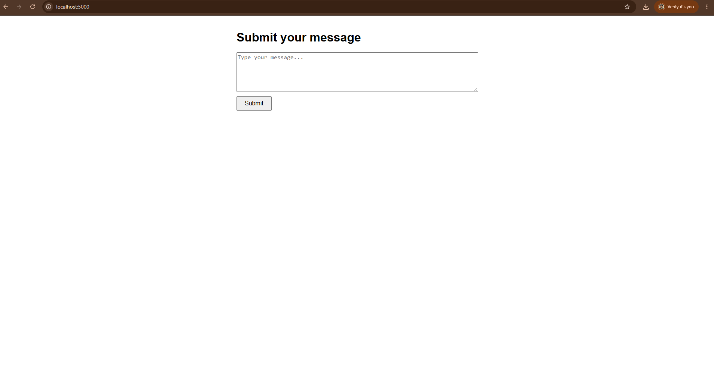
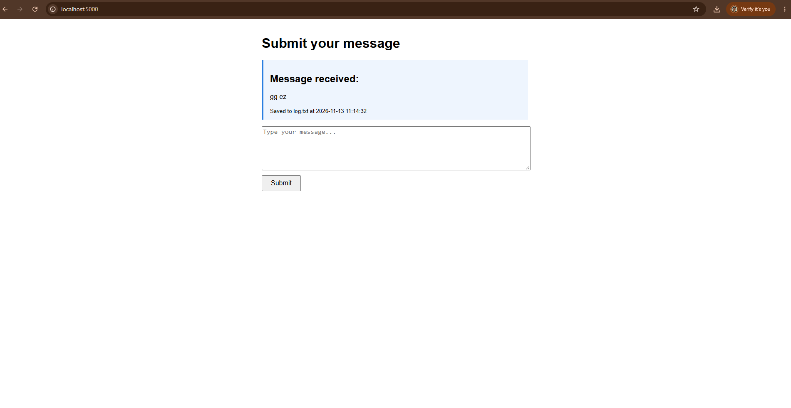

# NetworkPro Lab 2 – Flask + Docker (6814951011)

Chapter 2: Network Communication Protocols (โพรโทคอลการสื่อสารในเครือข่าย)

A Flask web app that takes a message from a web form (**HTTP POST**), shows it on the page, and appends it to **`log.txt`** inside the container.

## Project structure
```
.
├── app.py                 # Flask app (GET = form, POST = show + append to log.txt)
├── Dockerfile             # python:3.10-slim + Flask
├── requirements.txt       # Flask==2.3.2
├── docker-compose.yml     # service: web_app, port 5000
├── log.txt                # sample log from a real run
├── screenshots/           # proof of work
├── exercise1-simple-web-server/   # Exercise 1: http.server (GET ?msg= + POST) + requests client
└── exercise2-udp-communication/   # Exercise 2: UDP server/client with docker-compose
```

## How to run
```bash
git clone https://github.com/11Phacharaphon/NetworkPro-lab2-6814951011.git
cd NetworkPro-lab2-6814951011
docker-compose up --build -d
```
- Open http://localhost:5000, type a message, and click **Submit**
- Check the log inside the container:
```bash
docker-compose exec web_app cat log.txt
```
- Clean up:
```bash
docker-compose down --rmi all
```

## Screenshots

### 1. Web form


### 2. After submitting (message received)


Second test:




### 3. Terminal: `docker-compose up` (POST request logged)


### 4. Terminal: `log.txt` inside the container


```console
$ docker-compose exec web_app cat log.txt
[2026-11-13 11:00:12] Hello from Docker! - Network Programming Chapter 2
[2026-11-13 11:00:12] สวัสดีครับ ทดสอบภาษาไทย
[2026-11-13 11:03:22] hi
[2026-11-13 11:07:57] hi
[2026-11-13 11:13:20] hi hello
[2026-11-13 11:14:32] gg ez
[2026-11-13 11:17:05] ..................
```
The same file, copied out of the container: [log.txt](log.txt)
